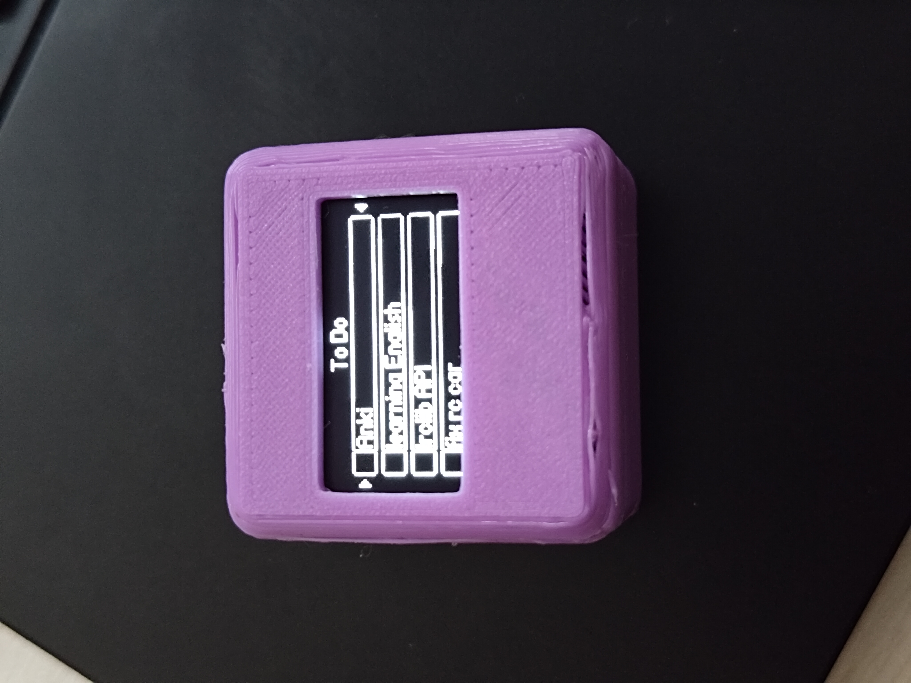

### Simple ESP32 to do list
This project uses xiao esp32c3, 0.96 inch OLED screen with encoder and two airpods batteries connected in parallel. Pinout can be found in **constants.h**

## Flashing
- Open sketch in arduino IDE
- Install necessary libraries
- Flash sketch
- Flash littlefs data using [arduino-littlefs-upload](https://github.com/earlephilhower/arduino-littlefs-upload)
